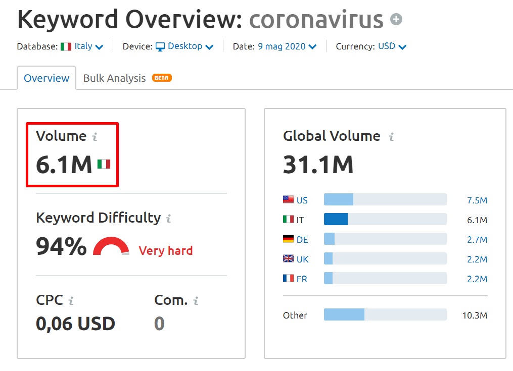
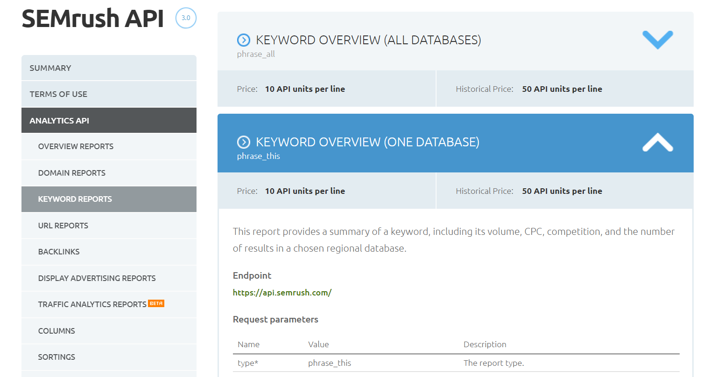

Qualche settimana fa notavo che **Google Keyword Planner oscura i volumi di ricerca per la chiave *coronavirus***. Un bel problema per chi ad esempio si occupa di progetti editoriali e vuole anche solo quantificare a grandi linee il potenziale di ricerche collegato ad una keyword.

Una possibile soluzione in questi casi è **utilizzare piattaforme a pagamento come SEMrush** che forniscono delle stime. In agenzia abbiamo un account SEMrush e dunque possiamo verificare questi dati direttamente dalla UI, come mostrato sotto.



*Volume di ricerche per la chiave coronavirus su SEMrush*

Tuttavia, come spesso accade in questi casi, preferisco scalare l'attività in modo da avere più dati, più rapidamente e imparare qualcosa di nuovo con Python :)

## API di SEMrush FTW!

A questo scopo ho provato ad utilizzare le API di SEMrush per le quali innanzitutto ho verificato **se fossero già disponibili online dei tutorial** da cui prendere spunto. Mi sono imbattuto [in un post su Medium di un Senior SEO Analyst](https://medium.com/@Derek_M_Hawk/want-a-ton-of-seo-data-consider-the-semrush-api-in-your-workflow-5fe1fc7fc49e), credo americano, che in modo semplice spiega come ha usato le API per avere "tonnellate" di dati.

Ho quindi **creato un notebook su Colab, ci ho messo dentro codice preso dal post** **e poi l'ho rimaneggiato** seguendo la [documentazione ufficiale delle Analytics API di SEMrush](https://it.semrush.com/api-analytics/), che tutto sommato ritengo fatta bene, efficace ed efficiente.

## Come funziona lo script che ho prototipato

Ecco step by step cosa ho realizzato sul notebook Colab, per chi volesse sperimentare. **La procedura che segue non richiede conoscenze pregresse di Python o delle API di SEMrush!**

*Disclamer: chi mi conosce sa che non sono un esperto Pythonista quindi il linguaggio che uso* *potrebbe****a volte** risultare inappropriato. A tutti gli esperti Pythonisti che dovessero leggere questo post per favore
scrivetemi nei commenti se è utile che modifichi o spieghi meglio qualcosa.*

### 1. Installare e avviare il client SEMrush

Il tutorial che dicevo sopra suggerisce di utilizzare un wrapper non ufficiale che è possibile installare su Colab direttamente da GitHub per poi avviare il client come segue.

```
! pip install git+https://github.com/storerjeremy/python-semrush.git

from python_semrush.semrush import SemrushClient

client = SemrushClient(key='INSERIRE_QUI_LA_PROPRIA_KEY')
```

Per ottenere la propria API key di SEMrush occorre possedere una sottoscrizione a pagamento della piattaforma e [seguire i semplici passaggi in questo tutorial ufficiale](https://it.semrush.com/kb/92-api-key).

### 2. Inserire alcune keyword di input

Per questo passaggio è sufficiente inserire le keyword di partenza in una lista in Python. In questo caso la lista che ho utilizzato è stata denominata "yourKeywords".

```
yourKeywords = ['coronavirus, coronavirus italia']
```

### 3. Ottenere i dati per singola keyword di input

Il seguente snippet di codice può essere descritto come: "per ogni keyword della lista di input, faccio una chiamata a SEMrush chiedendo l'estrazione di alcuni dati dal database italiano".

```
for every in yourKeywords:

keywordInfo = client.phrase_this(phrase=every, database='it')

print (keywordInfo)
```

La forma qui utilizzata è un cosiddetto "ciclo for" - o "for loop" in Inglese - che consente di ripetere una stessa azione *n* volte.

*phrase\_this* è il nome del report di SEMrush di cui è possibile ottenere maggiori informazioni nella documentazione delle Analytics API.



*I Keyword Reports nella documentazione delle API di SEMrush*

### 4. Ottenere le correlate a ciascuna keyword di input

In combinazione, o in alternativa, al passaggio precedente è possibile anche ottenere le correlate alle keyword di input.

```
for every in yourKeywords:

keywordInfo = client.phrase_related(phrase=every, database='it', display_limit=10, export_columns='Ph,Nq')

for item in keywordInfo:

print(every + "|" + item['Keyword'] +"|"+ item['Search Volume'])

print("DONE")
```

Qui ho utilizzato due for loop - uno dentro l'altro affinché il risultato venisse stampato in maniera per me leggibile - e richiesto i dati del report *phrase\_related*.

Di questo report chiedo a SEMrush mi siano restituiti i dati dal database italiano, in particolare 10 risultati per ciascuna keyword di input, e chiedo che l'output consista nella keyword correlata e nel rispettivo volume di ricerche.

## Conclusioni sulle API di SEMrush

Creare questo semplice prototipo su Colab è stato divertente e soprattutto ho potuto scaricare molti dati che Keyword Planner per il momento non restituisce.

Tuttavia, **rimango dubbioso sull'attendibilità dei dati**. Infatti, tra le varie keyword ho notato che:

* alla chiave "coronavirus milano" vengono assegnate 0 ricerche/mese
* alla chiave "coronavirus pistoia" vengono invece assegnate 6600 ricerche/mese!

Insomma, se i dati di SEMrush possono **comunque ritenersi interessanti ad es. per ottenere nuove idee** per un'analisi delle ricerche, non sono certo di poter dire che i dati sui volumi di ricerca siano attendibili, perlomeno non in questo caso specifico.

Per questa ragione, dopo vario smanettare sono arrivato ad una **soluzione alternativa che sfrutta i dati di Google Trends**... ma di questo magari scrivo in un prossimo post.

Share:
