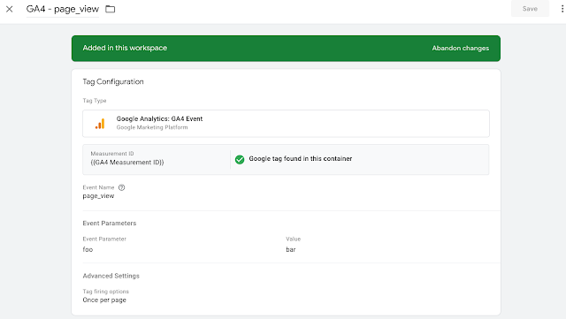
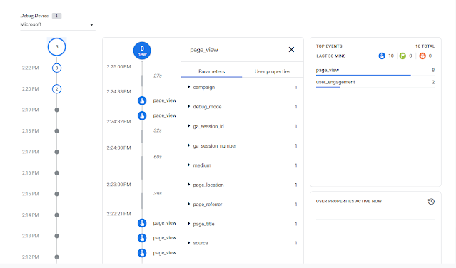
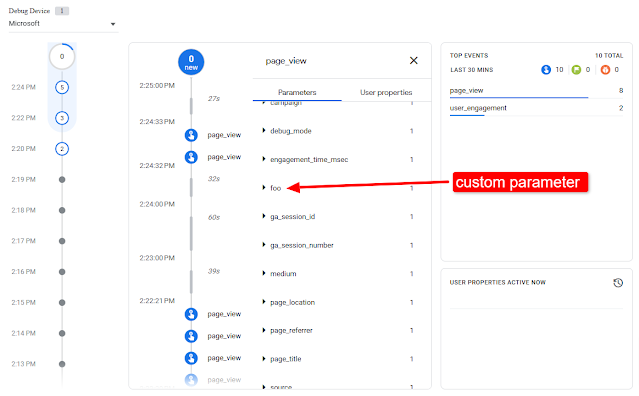

Some days ago I found a question on Reddit asking [what happens when Custom Event and GTM GA4 Event have the same event\_name?](https://www.reddit.com/r/GoogleAnalytics/comments/17fa6k9/what_happens_when_custom_event_and_gtm_ga4_event/) I wanted to be 100% sure about the answer so **I decided to do a pretty simple test** I will show in the next lines.

The most complete guide I’ve found about duplicate events in Google Analytics 4 is of course something by Julius: <https://www.analyticsmania.com/post/duplicate-events-in-google-analytics-4-and-how-to-fix-them/>.

Unfortunately, that wasn’t enough for what I wanted to prove, so I hope I can help someone sharing how I tested it, precisely tackling the question.

## How I set GTM to duplicate an automatic event

First things first, **I set a GA4 event tag on Google Tag Manager replicating an automatic event**. I’ve chosen the GA4 event page\_view, but it could have been anything else.

Triggers were exactly the same to be sure they fired at the same time (see snapshot below).

  The Google Tag - sending a page_view - and the parallel custom GA4 page_view event I set](img-01-68c9d7.png)

*The Google Tag - sending a page\_view - and the parallel custom GA4 page\_view event I set*

The GA4 event tag was set by adding just a custom parameter to let me easily recognize what I was looking at in the DebugView.

*The GA4 event tag is set with a custom parameter foo with value bar*

## Results: Will both automatic and custom GA4 events fire?

I haven’t published my new version of the GTM container but simply used the Google Tag Assistant to test the results in the GA4 DebugView.

The results were straightforward. **Both the automatic page\_view and the custom page\_view were fired.** The first page\_view event was the automatic one while the second contained the custom parameter foo.

*page\_view automatic event automatically created by GA4*

  

*page\_view custom event with custom parameter foo*

Here we go, a complete test to successfully prove what happens when automatic events get duplicated with custom ones. **There’s no deduplication on Google’s side, so look out!**

Share:
