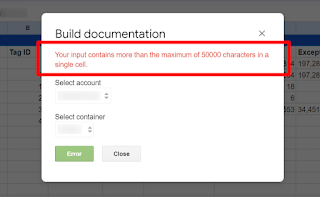
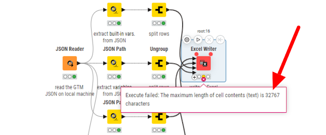
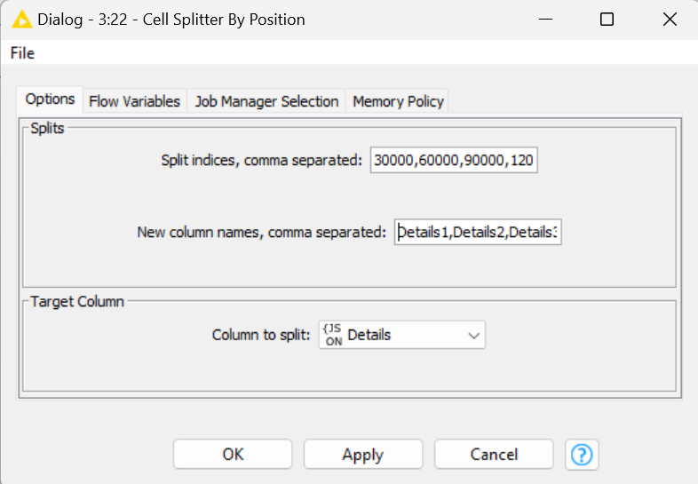
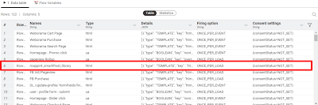

Most of the time you can easily convert a Google Tag Manager JSON file to an
Excel one with some free tools.

The best tool of this kind is probably the Google Sheets extension “[GTM Tools](https://www.simoahava.com/tools/gtm-tools-by-simo-ahava/)” by the almighty Simo Ahava.

Unfortunately, the free superpowers of this add-on can encounter some bitter
moments where things go wrong, as well as any other tool.

## The issue with Google Sheets characters limit in a single cell

I was trying to wrap my head around a GTM setup so I decided to use GTM Tools
to simplify the overview of tags and triggers.

During the processing phase of the GTM container assessed,
**I got a strange error message breaking the workflow**.

*The error message raised by GTM Tools Google Sheets extension*

The issue is that one of the tags was more than 50k characters long - I know
that sounds crazy - which is the maximum limit of chars available in Google
Sheets!

## KNIME to the rescue… maybe

I’ve used KNIME in the past to automate some tasks. One of the most
interesting stuff I [published in KNIME Hub](https://hub.knime.com/fryfella/spaces/Web%20Analytics%20workflows/latest/Google_Tag_Manager_JSON_to_Excel~ped1JbjH-YztQtPz)
was a simple workflow taking a GTM JSON file and converting it to an Excel
one.

I must be honest, I’ve usually preferred GTM Tools since it’s a bit more
hassle-free, a couple of clicks and you’re there. In this case, I thought my
little KNIME application using Excel instead of Google Sheets could have made
my day.

Unfortunately that was not the case
**since Microsoft Excel has got its own limit of 32k characters** which is
even less than the Google Sheets one!

*The error message raised by the KNIME Excel Writer node 😟*

## How I made it work

The easiest way I found to make it work, was to edit the KNIME application
looking for **a way to split****into multiple columns****the cell content related to the infamous tag**, before the Excel Writer
node was run.

Here below is how the workflow appears after adding a couple more KNIME nodes:
The *Cell Splitter By Position* node - in charge of splitting the
content - and the *Column Filter* node - used to remove the original
column with the extra large content to split.

*The final KNIME workflow with the Cell Splitter By Position and the
Column Filter nodes in the 3rd branch*

In particular, to make it work, I set 4 split indices to split the content
when it reaches 30k, 60k, 90k or 120k characters.

For each split the node will create a new column. The original column coming
from the GTM JSON was named *Details* so I decided to just name them
*Details1*, *Details2* and so on, *Details5* being the
last one at the 4th split.

*Configuration of the Cell Splitter By Position node*

The table previews generated by KNIME are quite straightforward about the
results of the node.

*The table preview before applying the Cell Splitter By Position node*

*The table preview after applying the Cell Splitter By Position node (we
will remove the original Details column with the next node)*

And that worked like a charm. Now my GTM JSON file perfectly fits a simple
Excel file!

Share:
