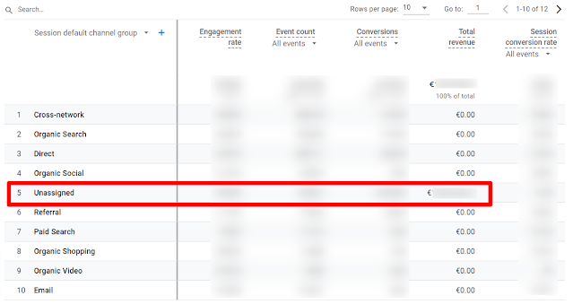
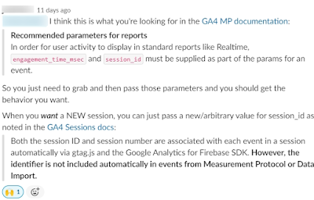
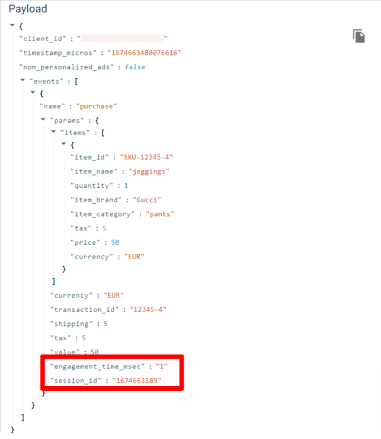
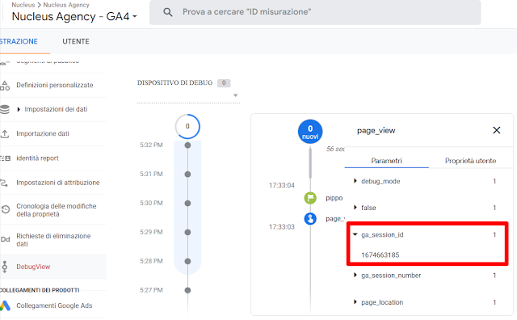
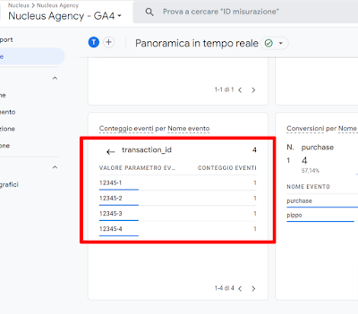
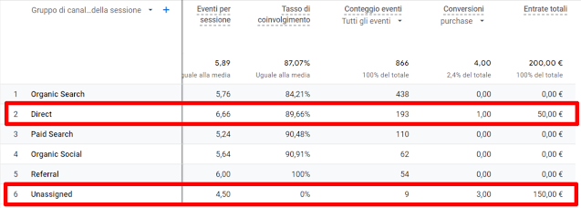

Today, I'm going to show a simple yet powerful experiment I've made with Google Analytics Measurement Protocol.

I was looking for ways to do this test with Python or R but the [Google Analytics 4 Event Builder](https://ga-dev-tools.web.app/ga4/event-builder/) proved to be more than enough.

## Where it all started

I'm working with a client who needs sending purchase events to Google Analytics through Measurement Protocol (long story short).

After a first implementation we've found everything was correct but purchase events were not tied to any information about the channel driving them.

*Transactions are coming from Unassigned*

  

## God bless Measure Slack

There are no words to describe how Measure Slack helps with these issues: It's awesome!

In this particular case I wasn't actively looking for an answer to my problem but, all of a sudden, I've found one person with the same exact issue I had, WOW.

The first reply to his question was the answer to my issue!

*First reply in Measure Slack pointing towards Google documentation*

  

As a matter of fact, in its documentation [at this link](https://developers.google.com/analytics/devguides/collection/protocol/ga4/sending-events?client_type=gtag&hl=en#recommended_parameters_for_reports), Google recommends:

> In order for user activity to display in standard reports like Realtime, engagement\_time\_msec and session\_id must be supplied as part of the params for an event.

## Time to test with the GA4 Event Builder

I trust people in Measure Slack but I needed to test things out to be sure there were no drawbacks and to be confident passing this information to the developer team.

My plan was to send events through the Event Builder with and without the engagement\_time\_msec and session\_id parameters to see what could happen.

Here follows an example payload I've made using the GA4 Event Builder (with those two parameters populated):

*An example payload with engagement\_time\_msec and session\_id parameters*

  

To populate those fields two things to keep in mind:

1. engagement\_time\_msec can be anything so I decided to put a simple 1 in there (UPDATE: Simo actually tested and reported in the same Slack thread that this parameter is probably not needed at all)
2. session\_id should instead be something real so I had to take this information from a debugging session with Google Analytics Debugger, the Chrome extension available [here](https://chrome.google.com/webstore/detail/google-analytics-debugger/jnkmfdileelhofjcijamephohjechhna).

*Where to find the session\_id in Google Analytics DebugView*

## Results

I tested all the transactions have been sent to GA4 with a simple check on the Real Time report

*transaction\_id s tracked in  the Real Time report*

  

Then I waited some hours to dive deeper on the transactions tracked. The next day I've found sessionization have worked astonishingly well.

*Session default channel groups with right attribution of transactions*

  
I've actually sent 3 purchase events without engagement\_time\_msec and session\_id and just one with both of them. 

Indeed, 3 purchase events were not sessionized so got attributed to Unassigned, the one with both additional parameters was associated to Direct correctly.

Share:
