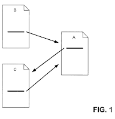
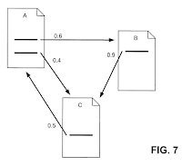
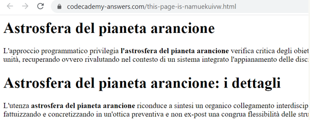
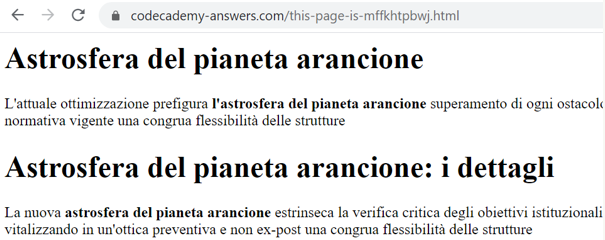
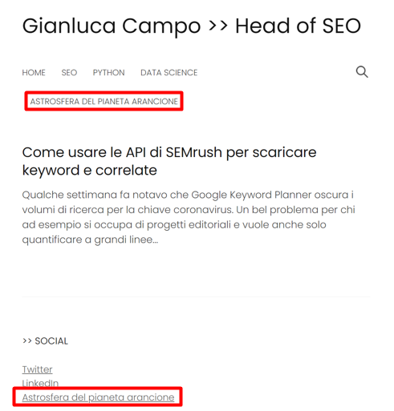
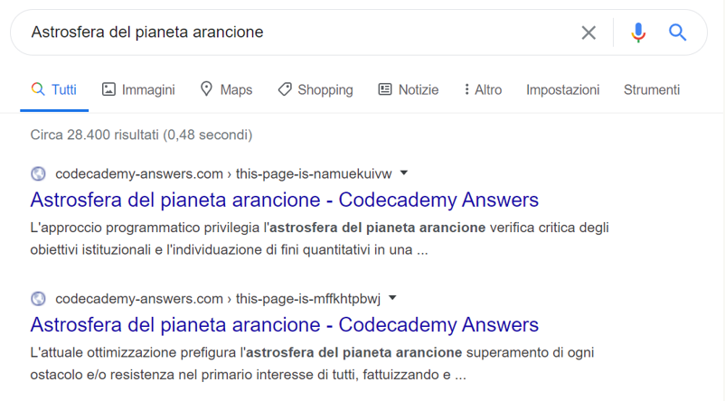
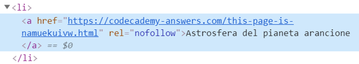
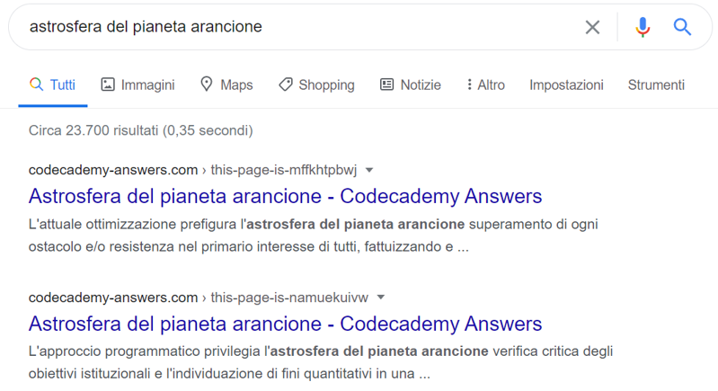
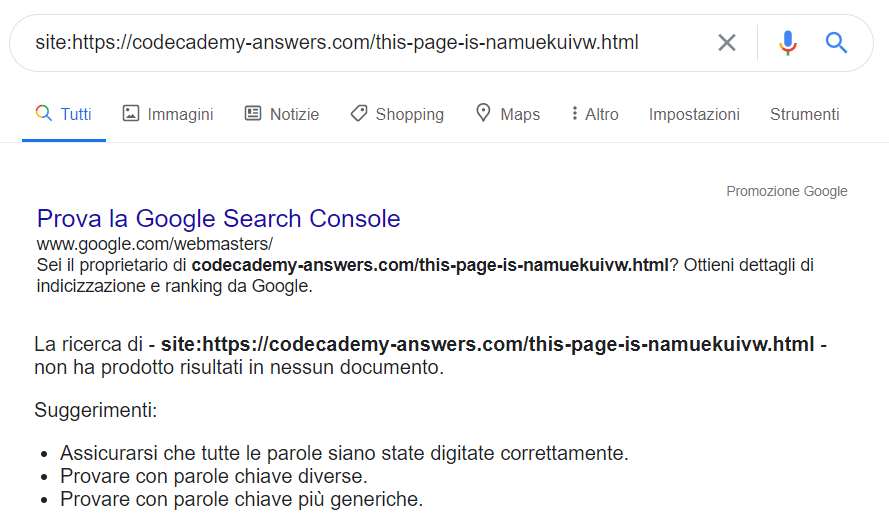
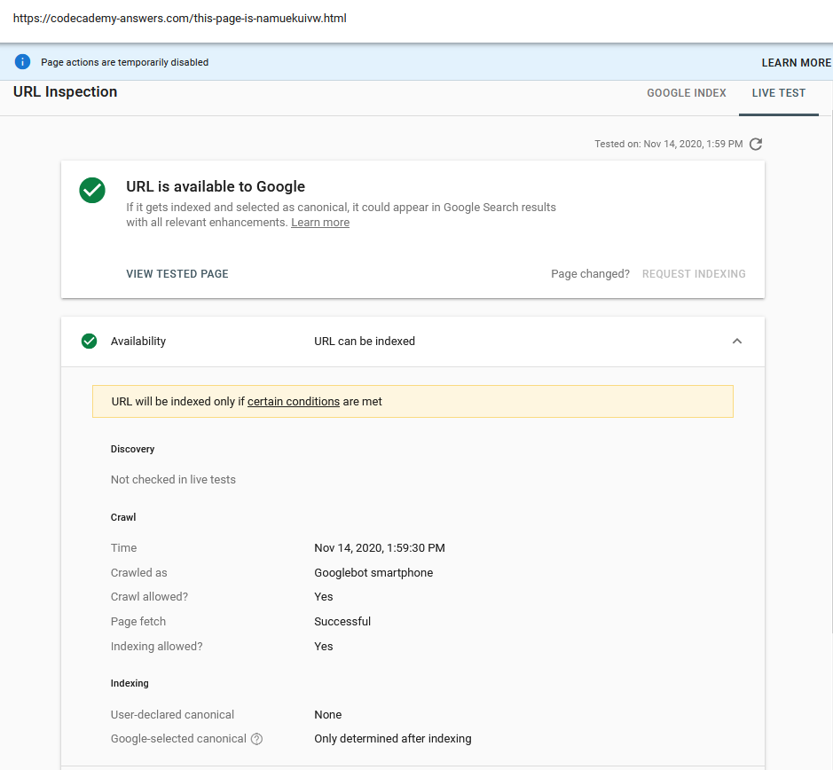

A fine settembre **ho partecipato all'Advanced SEO Tool** con la presentazione dal titolo "Advanced Link Analysis: nozioni ed esempi di automazione". Nella presentazione ho:

* trattato nozioni di base (e storiche) su PageRank, la sua evoluzione nel tempo
* mostrato alcune novità su come Google considera i link e gli attributi a essi associati
* presentato il [framework TIPR di Kevin Indig](https://www.kevin-indig.com/internal-link-optimization-with-tipr/), utile ad analizzare la distribuzione di valore interna ad un sito
* mostrato uno script in Python che, partendo dalle basi teoriche del TIPR, calcola le distribuzioni di PageRank, CheiRank, assegnando un peso iniziale alle risorse derivante dai backlink esterni.

Le slide prima o poi le pubblicherò su SlideShare ma qui in realtà **vorrei soffermarmi su un paio di simpatici esperimenti** che ho realizzato su questo blog e che ho trovato divertenti e interessanti.

## I link nofollow secondo Google: contesto

A **settembre 2019 Google ha comunicato** con [questo post sul Google Webmaster Central Blog](https://webmasters.googleblog.com/2019/09/evolving-nofollow-new-ways-to-identify.html) che avrebbe:

* introdotto gli attributi rel="sponsored" e rel="ugc" per particolari casi di link rispettivamente sponsorizzati o dovuti a user-generated content
* modificato il proprio modo di interpretare il nofollow da direttiva a suggerimento.

In particolare, il secondo punto mi è sembra molto interessante. Piuttosto che fidarsi dei webmaster, Google ha deciso che in alcuni casi potrà ignorare del tutto il rel="nofollow".

Inoltre, **Google ha comunicato una timeline precisa** dicendo che avrebbe da subito considerato nofollow un suggerimento ai fini del ranking

> All the link attributes, sponsored, ugc and nofollow, now work today as hints for us to incorporate for ranking purposes.

ma lo avrebbe considerato un suggerimento anche ai fini del crawling solo a partire da marzo 2020

>  For crawling and indexing purposes, nofollow will become a hint as of March 1, 2020.

Inutile dire che da buon SEO curioso e smanettone quale sono il comunicato è sembrato subito pane per i miei denti e ho voluto verificare quanto ci fosse di vero.

La presentazione all'Advanced SEO Tool è stata quindi **l'occasione giusta per mettere in piedi alcuni piccoli esperimenti** da presentare all'audience.

## Un po' di reasonable surfer model

Prima però di parlare dell'esperimento sul nofollow ho trattato un po' un altro aspetto che ritenevo interessante.

Nonostante ne siamo tutti più o meno consapevoli per l'esperienza che maturiamo sui siti, non ricordo infatti alcuna **dimostrazione plastica degli effetti del reasonable surfer model** sull'importanza dei link.

### Cos'è il modello del navigatore razionale

Il reasonable surfer model è il modello introdotto per migliorare la prima versione del PageRank di fine anni '90, pensato da Larry Page e Sergey Brin.

Il [PageRank originario infatti utilizzava il cosiddetto random surfer model](http://ilpubs.stanford.edu:8090/422/1/1999-66.pdf), cioè un modello in cui l'utente clicca i link in pagina in maniera totalmente casuale.

*Nel random surfer model tutti i link hanno la stessa probabilità di essere cliccati*

Con [l'introduzione del reasonable surfer model nei primi anni 2000](https://patents.google.com/patent/US7716225B1/en), invece, il PageRank comincia a ponderare alcune caratteristiche legate ai link, come ad esempio la loro posizione in pagina.

*Nel reasonable surfer model alcuni link hanno maggiori probabilità di essere cliccati*

## Esperimento #1: il reasonable surfer model

### 1. Creazione delle pagine di test

Per testare l'importanza della posizione dei link, **ho creato due pagine simili ma non duplicate** con:

* title e tag heading uguali che puntassero alla chiave target "astrosfera del pianeta arancione", inventata di sana pianta
* testo non duplicato, ma generato con uno strumento online che inserisce frasi dell'ambito giuridico in ordine random
* struttura e quantità di testo praticamente equivalenti
* URL contenenti sequenze di caratteri casuali.

 Le due pagine sono state pubblicate su un altro sito di mia proprietà, codecademy-answers.com.

*Le due pagine di test, simili ma non duplicate*

### 2. Link nel menu e nel footer

Ho quindi inserito **due link in questo blog con lo stesso anchor text, uno nel menu principale, l'altro nel footer**.

Il primo link con puntamento alla prima pagina di test vista sopra, il link nel footer invece verso la seconda.

*I due link inseriti nel menu e nel footer*

### 3. Risultati

Dopo aver atteso un po' perché Google indicizzasse le due pagine, la prima ha ottenuto un ranking più alto della seconda, verosimilmente perché linkato nel menu principale.

*La pagina linkata nel menu ottiene un ranking migliore*

## Esperimento #2: il nofollow come "hint"

Fatto questo non mi restava che provare a capire **se il nofollow potesse o meno avere impatti nel ranking** delle due pagine di test.

Ciò che mi aspettavo da questo test è che il nofollow sarebbe stato perlopiù ignorato e quindi non avrebbe cambiato il peso delle due risorse per il ranking.

### 1.  Inserimento del link nofollow

Ho dunque inserito un rel="nofollow" in corrispondenza del link nel menu per provare a diminuirne la trasmissione di PageRank.

*I l rel="nofollow" nel link del menu*

### 2. Risultati

La SERP per la chiave target ha mostrato quasi subito un'inversione del ranking delle due pagine come se in realtà **il nofollow continui a essere considerato una direttiva più che un "hint"**, almeno nell'immediato.

*Il ranking delle due pagine viene invertito*

## Altre indicazioni dai test

Dopo qualche settimana, ho notato che Google ha addirittura deindicizzato del tutto la pagina con link nofollow.

*La pagina con link nofollow è stata deindicizzata*

Quindi mi è nato il sospetto - e ho voluto verificare - che per il motore di ricerca le pagine non fossero in realtà duplicate. Lo strumento Ispeziona URL di Google Search Console non ha però segnalato alcuna anomalia.

*Ispeziona URL non segnala anomalie neanche dopo live test*

Vorrei cercarne conferma online, ma questo mi fa pensare - e mi sembra anche corretto nell'ottica di risparmio di informazioni non necessarie per il motore - che Google possa rimuovere dall'indice i nodi che in effetti risultano anomali perché linkati solo attraverso un link nofollow.

## Possibili conferme che il nofollow non è ancora un "hint"

D'altronde, a giugno di quest'anno, nella puntata dell'ottimo podcast Search Off The Record, intitolata Pop filters, nofollow, Core Web Vitals, and more!, Gary Ilyes ha affermato che Google (minuto 2:32):

* si è “concesso” di considerare nofollow un suggerimento
* non ha ancora nulla di nuovo da annunciare
* sta lavorando su alcune cose che potrebbero essere utili a web e webmaster.

A livello pratico mi aspetto quindi che per chi ha fatto uso di nofollow fino ad ora può continuare a farlo come se nulla fosse cambiato.

Share:
