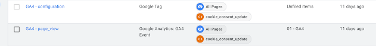

Pagina di prova (draft, non viene pubblicata) per verificare la resa di tutti gli elementi.

## Titolo di sezione H2

Testo normale con **grassetto**, *corsivo* e `codice inline`. Icone:   

### Sottosezione H3

| Metrica | GA4 | Universal |
|---|---:|---:|
| Sessioni | 1.240 | 1.310 |
| Utenti | 980 | 1.002 |
| Conversioni | 42 | 39 |

## Codice

```python
import pandas as pd
df = pd.read_csv("events.csv")
print(df.groupby("event_name").size())
```

## Matematica


Inline: \(CR = \frac{conv}{sessions}\)

$$
\text{ROAS} = \frac{\sum_{i=1}^{n} revenue_i}{spend}
$$

## Immagine (click per ingrandire)




Box di avviso con icona, utile per note e warning.

