This post comes from the notes I wrote down before taking the Google Analytics 4 Certification. 

To be honest I think this time the Google Analytics material is way too long and verbose than how it was in the Google Analytics Academy for the previous certification.

I believe this post is a bit too long as well, however it could be helpful for those who want to take the Google Analytics 4 Certification and would like a summary of the material provided by Google on its Skillshop website. This is the reason why I'm sharing it here exactly as I wrote it for me.

I strongly recommend copy/pasting this summary in a Google Docs/Microsoft Word file and use the headings to reshape the text structure as desired.

Enjoy!

========================================

  

# 1. Discover the Next Generation of Google Analytics

## 1. Discover What’s New with Google Analytics

[Discover What’s New with Google Analytics : Google (exceedlms.com)](https://skillshop.exceedlms.com/student/path/66729/activity/89201)

### 1. What's a GA property?

In the past, there were only two kinds of properties: Universal Analytics for measuring websites, and Google Analytics for Firebase for measuring mobile app activity. But now, the Google Analytics 4 property can collect both types of data. 

1. Scales with your business: It can measure, unify, and de-duplicate all the interactions people have with your company across devices and platforms
2. Adapts to a changing environment: It offers responsible, durable measurement that enables business outcomes for the long-term while meeting user expectations for privacy.
3. Reveals intelligent business insights: It automates and facilitates insight discovery with the power of Google’s machine learning
4. Helps you achieve your marketing goals: It allows you to more effectively take action on your data and insights to achieve measurable marketing outcomes.

### 2. Integrated reporting

More and more, people expect to interact with businesses however is most convenient for them — for example, researching a product on their phone and then purchasing it later on their computer. Getting insight into these user journeys is critical for you to predict your customers’ needs and provide great experiences

1. Full reporting across devices: Users often switch devices or profiles as they interact with your website. The latest Analytics experience can de-duplicate users across data from different devices.
2. Unified web and app reporting: This experience allows you to measure apps and websites together across all reports for the first time in Analytics.
3. Integrated reporting and analysis: The latest Google Analytics experience can seamlessly and intelligently combine all your data streams to report key insights unique to your business.

### 3. Key takeaways

1. The GA4 property type is the next generation of Google Analytics and is designed to scale with your business and measure across devices and platforms.
2. GA4 properties are built to handle data from both websites and apps.
3. The latest Analytics experience is fully operational today, but new features and innovations are still being added.

## 2. What Sets Google Analytics 4 Properties Apart

[What Sets Google Analytics 4 Properties Apart : Google (exceedlms.com)](https://skillshop.exceedlms.com/student/path/66729/activity/89202)

### 1. How GA4 properties differ from Universal Analytics properties

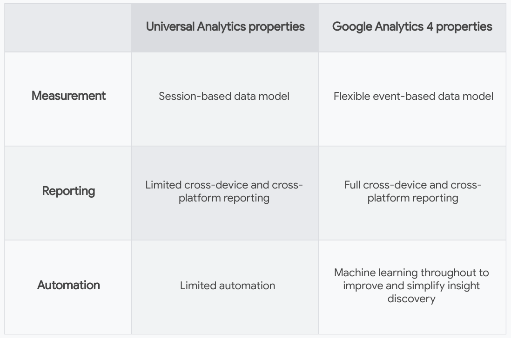

Some more key differences

1. Audiences: With GA4 properties, it’s easy to create new audiences, and you have more options when defining and segmenting your audiences. If your business creates IDs for signed-in users, GA4 properties allow you to use this data when building audiences.
2. Advanced features available to all Analytics accounts:

1. Explorations: Interpret your data with greater freedom using the Explorations tool.
2. BigQuery Export: Export your Analytics data to BigQuery so you can securely store your data in the cloud, combine it with data from other sources, and run queries across all your data sets.

### 2. How GA4 properties collect and process data

1. The session-based model: In UA properties, Analytics groups data into sessions, and these sessions are the foundation of all reporting. A session is a group of user interactions with your website that take place within a given time frame. During a session, Analytics collects and stores user interactions, such as pageviews, events, and eCommerce transactions, as hits.
2. The event-based model: In GA4 properties, you can still see session data, but Analytics collects and stores user interactions with your website or app as events. Events provide insight on what's happening in your website or app, such as pageviews, button clicks, user actions, or system events. Events can collect and send pieces of information that more fully specify the action the user took or add further context to the event or user.
3. Benefits of the event-based model: By moving to event-based collection, Analytics is more flexible, scalable, and is able to perform more custom calculations, faster.
4. More about events in Google Analytics 4 properties: Many basic interactions with your website or app are automatically collected as events in the latest Analytics property. For example, the first time a user visits your website, the property will log this action as a “first visit” event. You can also enable the enhanced measurement feature, an option that lets you automatically collect more events without having to update your website's code. Enhanced measurement allows you to measure many common web events like pageviews, scrolls, file downloads, and video views.

### 3. Identity spaces in Google Analytics

When trying to understand user journeys, Analytics can use several different user identifiers

1. User-ID: If you create your own persistent IDs for signed-in users, you can use this data to accurately measure user journeys across devices. To enable the User-ID feature, you must consistently assign IDs to your users and include the IDs along with the data you send to Analytics
2. Google signals: With Google signals enabled, Analytics associates event data it collects from users on your site with the Google accounts of signed-in users who have consented to sharing this information.
3. Device ID: On websites, the device ID comes from the user’s browser. On apps, the device ID comes from app-instance ID. You don't need any further setup in Google Analytics to use device ID.

### 4. Identity spaces in UA properties vs. GA4 properties

1. Identity spaces in UA properties: In UA properties, most reporting relies heavily on device ID, although a few reports and features can also use the Google signals identity space. When the User-ID feature is enabled, its data is reported separately from the rest of your data and doesn't integrate with other identity spaces.
2. Identity spaces in GA4 properties: In GA4 properties, data is processed using all available identity spaces. First, Analytics looks for User-ID because this feature uses the data you collect. Next, it tries Google signals, and finally, if there isn't a match for either, it relies on the device ID.

  

What does this mean? When you only have access to one identity space, like device ID, a single person could appear as a different user every time they interact with your business on a different device.

  

For the first time in Google Analytics, every report in GA4 properties uses all available identity spaces, whereas in UA properties, most reports can only use device ID.

### 5. Key takeaways

1. With GA4 properties, it’s easy to create new audiences
2. GA4 properties collect and store user interactions with your business as events instead of sessions
3. GA4 properties combine the use of several different user identity spaces.

## 3. Get to Know Google Analytics 4 Properties

[Get to Know Google Analytics 4 Properties : Google (exceedlms.com)](https://skillshop.exceedlms.com/student/path/66729/activity/89203)

### 1. The next generation of Reports and Explorations

1. Answer key questions with reporting in GA4 properties. Instead of a very long list of predefined reports that try to cover every use case, a handful of overview reports each cover a single insight about your business in a summary card.
2. Explore your data in GA4 properties. If you’re looking for insights that the reports don’t cover, the Explore section gives you more customizable ways to analyze your data.

### 2. Get to know Reports in Google Analytics 4 properties

1. Summary reports. You’ll find many different reports listed on the left side of the Analytics interface. Each report shows a high-level snapshot of these insights using summary cards.
2. The Realtime report. This report shows you events that took place between five seconds and 30 minutes ago. The card-based layout is designed to quickly answer important questions about how your users are currently interacting with your business.   
   In this report you can:

1. See different segments of users side by side;
2. Easily create a new segment that you can also use in other reports.

### 3. Get to know Explorations

1. Free form exploration. This tool presents your data in a cross-tab layout, where you can arrange the rows and columns as you like and add the metrics you're most interested in. You can also apply different visualization styles. If you spot a significant data point, right-click on that data point to easily create an audience or segment from it and use it in other explorations. If you use the line chart visualization, you’ll see an automatic feature enabled called anomaly detection.
2. Funnel exploration. Funnel exploration lets you visualize the steps your users take toward a key task or conversion. You can also easily create audiences of users based on where they enter or exit the funnels you define. With this tool, you can define up to 10 steps in your funnels, up from five steps in UA properties' Custom Funnels. Plus, you can now analyze both closed funnels (where users must enter at the beginning of the funnel) and open funnels (where users can enter the funnel at any point).
3. Path exploration. While funnels only analyze a single, predefined path, path exploration is free-flowing and can follow any number of undefined paths, even ones you weren’t aware of or didn’t intend. Plus, you can define paths using either a starting point or an ending point. This helps you understand how users got to a certain step on their journey.
4. Segment overlap. Segment overlap lets you compare up to three user segments to quickly see how those segments overlap and relate to each other. This can help you isolate specific audiences based on complex conditions.
5. User exploration. User exploration lets you select specific groups of users, like people who both visited your website and downloaded your app, and learn more about each anonymous individual user's activities.
6. Cohort exploration. A cohort is a group of users who share a common characteristic identified in this report by a specific event the user has triggered. For example, all users who signed up this week for your newsletter belong to the same cohort.

Explorations are private by default. If you’re the creator, only you can view and edit them unless you choose to share.

### 4. Find what you need with the search tool

1. Search for instant answers. For example, you can search for “conversions last week from United States” and see the answer in the search panel. Select the search result to find more details.
2. Search for reports, admin pages, or insights. For example, if you start typing “conversions,” you'll see reports related to conversions. You can also search for more specific data, like “mobile users during the last week.”
3. Search for account or property configuration. To find configuration information, enter search terms like account ID, property ID, or measurement ID.
4. Search help content. If you need help with Analytics, enter a description of your subject, like “add web stream.”

### 5. Key takeaways

1. Reporting in GA4 properties is simple: A handful of overview reports each cover a single insight about your business
2. Use Explorations to drill even deeper into your data
3. Use the search box at the top of your Analytics account to find what you need.

## 4. Create Your Own Google Analytics 4 Property

[Create Your Own Google Analytics 4 Property : Google (exceedlms.com)](https://skillshop.exceedlms.com/student/path/66729/activity/89204)

### 1. Understand the Analytics property structure

1. Introducing data streams. Data streams are a feature of GA4 properties that allow you to connect a single Analytics property to the various places where your users interact with your business.  
   As you set up your Analytics account, consider how to map it to your existing business structure so you can collect and analyze data in the way that makes the most sense for your business.

   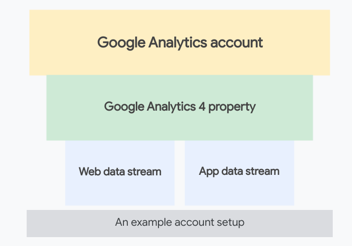
2. Different Analytics setups in practice. [...]
3. What to do if you already use Google Analytics. You can set up a new GA4 property and continue to use your existing UA property.

### 2. How to set up a Google Analytics 4 property

1. Step 1 — Open your Google Analytics account
2. Step 2 — Create a GA4 property
3. Step 3 — Create a data stream
4. Step 4 — Enable data collection
5. Optional next steps

1. Add recommended events. Measuring these additional events gives you more detailed data and lets you benefit from the latest Analytics features and integrations as they become available.
2. Link to Google Ads. If you use Google Ads, you can link your Ads account to your new property so they have access to each other’s data.

### 3. Verify the setup of your Google Analytics 4 property

Log into your Google Analytics account and open your new GA4 property to verify that data has started reporting. 

### 4. Key takeaways

1. In GA4 properties, you can set up a data stream for each platform where your users interact with your business
2. This Analytics experience is for everyone, whether you have a website, an app, or both
3. If you currently use Universal Analytics properties for your website, set up a GA4 property alongside it
4. Once you're done setting up a GA4 property for your business, verify your account setup by logging into your Google Analytics account

# 2. Use Google Analytics to Meet Your Business Objectives

## 1. Use Digital Analytics to Grow Your Business

[Use Digital Analytics to Grow Your Business : Google (exceedlms.com)](https://skillshop.exceedlms.com/student/path/297729/activity/444080)

### 1. Why use digital analytics?

If you run a business that has an app or a website, you probably have a lot of questions about how your brand is performing, like:

* How are users interacting with your app or website?
* How effective are your marketing campaigns?
* Which content is helping you achieve your business goals?
* Where are your users coming from, and where on your site or app are they are leaving?

### 2. The new world of measurement

Previously, we lived in a world of fully observable data with the help of things like cookies and device identifiers. Rising user expectations about privacy, more global regulations, and decreases in browser support for cookies have made for a more complex digital landscape, with gaps in digital measurement.

### 3. Where does that leave you?

Trying to understand how your online marketing is working while navigating the changing digital landscape might feel overwhelming, but it doesn't have to. Google Analytics can help you and your business stay on track.

### 4. Key takeaways

1. Digital analytics can help you understand how your customers are using your app or website
2. Rising user expectations about privacy, more global regulations, and decreases in browser support for cookies have made digital measurement more challenging
3. Google Analytics can help you and your business measure what you need

## 2. Use Analytics for Web, App, or Both

[Use Analytics for Web, App, or Both : Google (exceedlms.com)](https://skillshop.exceedlms.com/student/path/297729/activity/444081)

### 1. Customer journeys can be fragmented

Customer journeys are becoming more and more complex. In order to keep up, businesses need measurement tools that can stitch together these fragmented journeys

### 2. Google Analytics is for all your online business platforms

1. Full reporting across devices.  You can use Google’s signed-in data, bring your own identifier for signed-in users, or seamlessly use both, and Analytics will always choose the best available option for each situation.
2. Unified website and app reporting. Analytics allows you to measure apps and websites together in a common language across all reports. Events and conversions are reported the same whether they happen in an app or on the web.
3. Focused on privacy.

1. Control your data. Analytics lets you control the data that flows in through features like anonymizing IP addresses, disabling data collection, and setting data retention periods.
2. Fill in measurement gaps. Data modeling compensates for the absence of these signals by using models that are trained on observable data.

### 3. How to get started with Analytics

If you have a website, you can use Google’s dynamic tagging solutions. If you have an app, you can use Firebase.

If your business has a website, connect it to Analytics using one of Google's dynamic tagging solutions: the global site tag or Google Tag Manager. 

1. The benefits of manually deploying the global site tag. The most basic way to tag for Analytics is to manually deploy the global site tag.
2. The benefits of tagging with Google Tag Manager. Google Tag Manager uses the same back-end infrastructure as the global site tag, and it lets you manage your tags across several infrastructures in a single user interface.
3. Other ways to tag. If you're using a tag management system other than Google Tag Manager, reach out to your tag management system to find out the best way to deploy the global site tag for Analytics.

### 4. Connect your app to Analytics with Firebase

If you have an app, the Firebase SDK is the way to go. 

1. What's an SDK? SDK is short for Software Development Kit, which is a collection of software development tools in one installable package
2. What is Firebase? Firebase is Google's mobile application development platform.

1. First create a Firebase account if you don't already have one. Then create a Firebase project within your account.
2. A Firebase project is a container for your app within the Firebase platform. One Firebase project should contain all versions of a single app: iOS, Android, and web app.
3. Whether you built your app using Firebase or another platform, the Firebase SDK is how you connect your app to Analytics.

### 5. Key takeaways

1. Customer journeys are becoming more complex
2. The latest version of Analytics is built to handle multiple data sources from complex user journeys across both app and web
3. To connect Analytics with your website, use Google’s dynamic tagging solutions
4. To connect Analytics to your app, use Firebase.

## 3. Set Up an Analytics Account for Your Business

[Set Up an Analytics Account for Your Business : Google (exceedlms.com)](https://skillshop.exceedlms.com/student/path/297729/activity/444082)

### 1. Understand the Analytics account structure

1. An Analytics account is your gateway to Analytics. An account can include multiple properties and property types, but a property can belong to only one Analytics account
2. A property lives within an account. Properties are the containers for your reports based on the data you collect from your apps and sites. It's the level at which Analytics processes data and where Analytics can connect with other Google products, like Google Ads.
3. A data stream lives within a property and is the source of data from your app or website. A property can have one or many data streams.

### 2. The guiding principle of account structure

When structuring your Analytics account, remember this guiding principle: Each property should represent a specific user base.

If data should generally be analyzed together, that data should be in one Analytics property.

### 3. Identity spaces in Analytics

Groups of identifiers are called identity spaces.

1. User-ID. If you create your own persistent IDs for signed-in users, you can use this data to accurately measure user journeys across devices. To enable the User-ID feature, you must consistently assign IDs to your users and include the IDs along with the data you send to Analytics.
2. Google signals. Google signals uses data from users who are signed in to Google. With Google signals enabled, Analytics associates event data it collects from users on your site with the Google accounts of signed-in users who have consented to sharing this information.
3. Device ID. Analytics also automatically uses device ID as an identity space. On websites, the device ID comes from the user’s browser. On apps, the device ID comes from app-instance ID. You don't need any further setup in Analytics to use device ID.

### 4. Joining forces

Analytics looks for User-ID because this feature uses the data you collect. Next, it tries Google signals, and finally, if there isn't a match for either, it relies on the device ID. 

Because these identity spaces are used in all reports, they allow you to de-duplicate users and tell a more unified, holistic story about their relationships with your business.

### 5. Key takeaways

1. An account contains one or more properties, and a property contains one or more data streams.
2. When structuring your Analytics account, each property should represent a specific user base.
3. Activate all possible identity spaces to get better insight into user journeys.

## 4. Configure Your Analytics Property

[Configure Your Analytics Property : Google (exceedlms.com)](https://skillshop.exceedlms.com/student/path/297729/activity/444083)

### 1. How to use data streams

Once you've identified a user base you're trying to measure, create a property for that user base. Then create a data stream for each of the ways these users interact with your business.

### 2. What to do if you already use Google Analytics

Are you already using Universal Analytics for your website? No problem! You can set up a new Google Analytics 4 property and continue to use your existing Universal Analytics property.

### 3. What about views?

Google Analytics 4 properties don't use views, but you can learn how to filter data and report on subsets of data in a Google Analytics 4 property 

### 4. Key takeaways

1. A data stream lives within a property and is a source of data from your app or website
2. If you already use Universal Analytics for your website, set up a new Google Analytics 4 property and continue to use your existing UA property
3. New properties created in Analytics are GA4 properties by default.

## 5. Measure the Info You Need with Analytics

[Measure the Info You Need with Analytics : Google (exceedlms.com)](https://skillshop.exceedlms.com/student/path/297729/activity/444084)

### 1. How Analytics collects and processes data

1. Analytics collects data as events. Analytics collects and stores user interactions with your website or your app as events.
2. Automatically collected events and enhanced measurement.

1. Many basic intractions with your website or app are automatically collected as events in Google Analytics. For example, the first time a user visits your website, the property will log this action as a “first visit” event.
2. You can also enable the enhanced measurement feature, an option that lets you automatically collect more events without having to update your website's code. Enhanced measurement lets you measure many common web events like pageviews, scrolls, file downloads, and video views.

### 2. Key concepts: data collection fundamentals.

Analytics collects and measures a few other pieces of info along with events to give you the full picture of how your customers interact with your business.

1. User properties are attributes about who's using your app or website that can help you better understand segments of your user base, like geographic location or device used
2. Events are user interactions with a website or app that can be measured, like a video view
3. Event parameters are additional pieces of information, sent with events, that can further specify the action the user took,  like the name of the video or how long the user watched it.
4. Conversions are events that you've assigned a specific value, like a purchase or a download. You can measure many events, just be sure to mark the most important ones as conversions.   
   If you use Google Ads, you can link your Ads account to Google Analytics and see your Analytics conversions in Google Ads

### 3. Creating events

To be sure you're measuring the things that matter to your business, you'll likely need to create some more events

### 4. Understanding dimensions and metrics

1. First, Analytics collects these user interactions as events, event parameters, and user properties.
2. To represent this data in these reports, Analytics uses dimensions and metrics.

1. Dimensions answer the question “who, what, or where?”
2. Metrics answer the question “how many?”

### 5. Customize the data you collect

1. Scoping custom dimensions and metrics. Automatically collected dimensions and metrics are already scoped. But when you create your own custom dimensions and metrics, you need to understand their scope
2. How to choose your scope.

1. Are you trying to measure and report something specific about the events happening on your website or app? If so, you're interested in scoping by event.
2. Are you trying to measure and report something specific about the users interacting with your website or app? If so, you're interested in scoping by user.
3. Note that custom dimensions can either be event-scoped or user-scoped, but custom metrics can only be event-scoped.

### 6. What about sessions?

1. In Universal Analytics properties, Analytics groups data into sessions — these sessions are the foundation of all reporting in UA
2. In GA4 properties, events are the basis of reporting, but you can still report on sessions in GA4
3. You can create session-scoped dimensions and metrics in UA. You can't create session-scoped dimensions and metrics in GA4

### 7. Key takeaways

1. Analytics collects and stores data as events. Events are user interactions with a website or app that can be measured, like a click or a view
2. Conversions are events that you've assigned a specific value, like a purchase or a download
3. Analytics reports use dimensions and metrics to organize your data.

## 6. Learn How to Use Explorations in Analytics

<https://skillshop.exceedlms.com/student/path/297729/activity/444097>

### 1. Why data might look different between Reports and Explorations

1. Some metrics and dimensions available in Reports aren't supported in Explorations. So, when you open a report in Explorations that includes unsupported fields, those fields are dropped from the exploration.
2. Reports are unsampled, meaning they're based on 100% of the available data. Explorations, on the other hand, may be based on sampled data if the dataset is very large.
3. If you set your date range to include data from the past 48 hours, you may notice slightly different results depending on when the data is processed.

### 2. Key takeaways

1. Go to Explorations in Analytics to use advanced analysis techniques
2. Visit the Explorations snapshot to create new explorations
3. Use different exploration techniques to uncover deeper insights
4. Data in Reports and Explorations should typically look the same,  but there are times when they could be different

# 

# 3. Measure Your Marketing with Google Analytics

## 1. Measure What Matters with Conversions

[Measure What Matters with Conversions](https://skillshop.exceedlms.com/student/path/359080/activity/546472)

### 1. Get to know conversions and events in Google Analytics

1. If you use Google Ads, you can export your Google Analytics conversions to use for ad reporting and bidding!
2. If you have a Universal Analytics property, you use “goals” to measure similar activities as “conversion events” in a Google Analytics 4 property.

### 2. How to create and mark events as conversions

1. You need Edit permission to mark an event as a conversion. Mark an existing event as a conversion, or create or modify an event and mark that as a conversion.
2. Once you mark an event as a conversion, it appears in the Conversions page. New conversions may take up to 24 hours to appear in reports
3. Marking an event as a conversion doesn't affect data you've already collected, it only applies to new data.

### 3. Get to know conversion modeling

1. Google uses modeling to predict online conversions that can’t be observed directly.
2. Modeling allows for accurate conversion attribution without identifying users (for example, due to user privacy, technical limitations, or when users move between devices).
3. Including modeled conversions lets Google offer more accurate reporting, optimize advertising campaigns, and improve automated bidding.

### 4. How modeled conversions work

1. Google’s models look for trends between conversions that were directly observed and those that weren’t.
2. Based on this prediction, conversions are aggregated to include both modeled and observed conversions

### 5. What is Google's conversion modeling approach

1. ​Check for accuracy and communicate changes​. Modeled conversions are compared to observed conversions that were held back, and the information is used to tune the models
2. Maintain rigorous reporting. Modeled conversions are only included when there's high confidence of quality. If there isn’t enough traffic to inform the model, modeled conversions aren't reported.
3. Customize for your business. Google’s more general modeling algorithm is separately applied to reflect your unique business and customer behavior.
4. Don’t identify individual users. Google doesn’t allow fingerprint IDs or other attempts to identify individual users.

### 6. Modeled conversions in Google Analytics 4 properties

1. Google Analytics 4 properties include cross-channel modeled conversions as of July 2021. Historical data isn't impacted.
2. Core reports (such as the Events, Conversions, and Attribution reports) and explorations (to select event-scoped dimensions) include modeled data.

### 7. Understand when conversion modeling could work

1. When the ad interaction and conversion happen on different devices, conversions may be modeled.
2. Browsers that don't allow conversions to be measured with third-party cookies have conversions modeled based on a website’s traffic.
3. Browsers that limit the time window for first-party cookies have conversions (beyond the window) modeled.
4. Some countries require consent to use cookies for advertising activities. When advertisers use consent mode, conversions are modeled for unconsented users.
5. App platforms can require that developers obtain permission to use certain information from other apps and websites.

  

Note: When looking at Google Analytics reports, remember that attributed conversion data for each channel can still be updated for up to seven days after the conversion is recorded.

### 8. Key takeaways

1. A conversion is a type of event
2. Conversion modeling is used when conversions can not be directly observed
3. Google doesn’t allow fingerprint IDs or other attempts to identify individual users
4. Google uses modeled conversions only when there's enough data to confidently make a prediction.

## 2. Give Proper Credit with Attribution

[Give Proper Credit with Attribution](https://skillshop.exceedlms.com/student/path/359080/activity/546473)

### 1. Give credit where credit is due

Attribution is the act of assigning credit for conversions to different ads, clicks, and factors along a user's path to completing a conversion. 

An attribution model can be a rule, a set of rules, or a data-driven algorithm that determines how credit for conversions is assigned to touchpoints on conversion paths. 

Let’s look at each one.

1. Cross-channel models

1. Last click. Ignores direct traffic and attributes 100% of the conversion value to the last channel that the customer clicked through (or engaged view through for YouTube) before converting.  
   Examples  
   Display > Social > Paid Search > Organic Search → 100% to Organic Search  
   Display > Social > Paid Search > Email → 100% to Email  
   Display > Social > Paid Search > Direct → 100% to Paid Search
2. First click. Gives all credit for the conversion to the first channel that a customer clicked (or engaged view through for YouTube) before converting.
3. Linear. Distributes the credit for the conversion equally across all the channels a customer clicked (or engaged view through for YouTube) before converting.
4. Position-based. Attributes 40% credit to the first and last interaction, and the remaining 20% credit is distributed evenly to the middle interactions.
5. Time decay. Gives more credit to the touchpoints that happened closer in time to the conversion. Credit is distributed using a 7-day half-life. In other words, a click 8 days before a conversion gets half as much credit as a click 1 day before a conversion.
6. Data-driven attribution. Distributes credit for the conversion based on observed data for each conversion type. It's different from the other models because your account's data is used to calculate the actual contribution of each click interaction.

2. Ads-preferred last click model. Ads-preferred last click attributes 100% of the conversion value to the last Google Ads channel a customer interacted with before converting.   
   If there's no Google Ads interaction in the path, as in Example 3, the attribution model falls back to cross-channel last click.  
   Examples  
   Display > Social > Paid Search > Organic Search → 100% to Paid Search  
   Display > Social > YouTube Engaged View > Email → 100% to YouTube  
   Display > Social > Email > Direct → 100% to Email (fallback to last non-direct click)

### 2. Last click versus Data-driven attribution

1. Last click attribution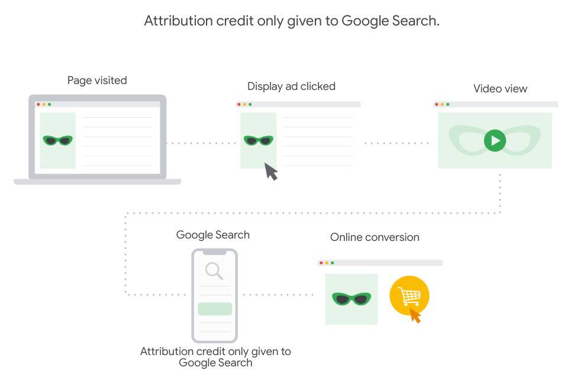
2. Data-driven attribution  
   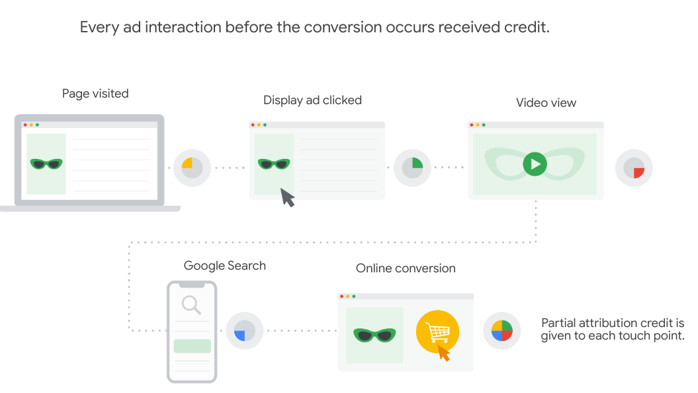

### 3. Benefits of Data-Driven Attribution

1. Free and easy-to-implement models enable consistent and deduplicated conversion measurement across platforms.
2. Calibrated with incrementality signals to give credit to the ads most contributing to advertiser goals.
3. When cross-channel export is available, seamless integration with Smart Bidding strategies in Google Ads for real-time optimization.

### 4. How is this different from data-driven attribution in Universal Analytics?

In a Google Analytics 4 property, data-driven attribution becomes even more powerful than UA by:

1. Bringing together user interactions and journeys across app and web.
2. Allowing engaged-views on YouTube to receive credit along with other interactions.

  

Get to know the Admin attribution settings

Users with the Editor role on the property can select an attribution model and lookback window at the property level to apply to a number of reports.

### 6. Get to know the model comparison reports (advertising workspace)

Use the model comparison report to compare how different attribution models impact the valuation of your marketing channels. 

Tip: Compare the Cross-channel last click model to the Cross-channel first click model to identify undervalued campaigns that are starting customers down the conversion path.

### 7 . Get to know the conversion paths reports (advertising workspace)

Use the conversion paths report to understand customers’ paths to conversion and how different attribution models distribute credit on those paths. 

The conversion paths report has two sections:

1. The data visualization helps you quickly see which channels initiate, assist, and close conversions.
2. The data table shows you paths users take to complete conversions, as well as the following metrics: Conversions, Purchase revenue, Days to conversion, and Touchpoints to conversion.

### 8. Key takeaways

1. Customer journeys are becoming more complex. To keep up, businesses need measurement tools that can stitch together
2. Data-driven attribution distributes credit for the conversion based on observed data for each conversion type.
3. Use attribution reports to get a better understanding of how advertising efforts work together to drive conversions.

## 3. Group Valuable Customers with Audiences

[Group Valuable Customers with Audiences : Google](https://skillshop.exceedlms.com/student/path/359080/activity/546474)

### 1. Audiences

Audiences let you segment users in ways that are important to your business. 

Use audiences in a number of ways:

1. Reporting in Analytics: Filter analytics reports by audiences you create
2. If using Google Ads, export audiences to use for ad targeting and bidding
3. Trigger events when users match the definition of an audience and become members. Mark those events as conversions and use them for things like bidding in Google Ads

### 2. Audience creation basics

Create an audience by setting conditions based on the dimension, metric, and event data you collect from a property. After you create an audience, it accumulates users who meet the conditions from that point onward.

  

Look at some options available when you create a new audience.

1. Scope. Set conditions to get the scope of when conditions must be met: across all sessions, in a single session, or in a single event.
2. Static vs. dynamic evaluation.

1. Static evaluation includes users if the condition was ever true for them.
2. Dynamic evaluation includes users when they meet the condition and excludes them when they don't.

3. Time-windowed metrics. Conditions also support time-windowed metrics. Specify that a metric condition can be true during any point in the lifetime of a user or that it must be true during a specific number of days.
4. Sequences. Sequences let you specify the order in which conditions must be met:

1. indirectly followed by (anytime after the previous step),
2. directly followed by (immediately after the previous step),
3. or within a specific time frame.   
   Sequences also let you specify scope for the entire sequence.

### 3. Predefined and new audiences

1. All users: Users who launched your app or visited your website.
2. Purchasers: Users who completed an in-app or eCommerce purchase.

To see existing audiences and create new ones, go to Configure > Audiences.

### 4. Create a new audience

1. Start from scratch, which lets you create a new audience by defining all the parameters yourself.
2. Use suggested audiences, which are additional audience suggestions for you to consider.   
   Get started by using a suggested audience, such as recently active users or non-purchasers. After selecting one, you can still customize the audience criteria before saving.

1. Templates. Audience templates are partially configured audiences that already identify a set of dimensions and/or metrics that form the basis of widely applicable audiences for app and web-based businesses.
2. Predictive audiences. Google Analytics uses machine learning to predict the future behavior of users based on their past behavior. That's called predictive metrics.

### 5. Building your Audience

As you define your audience using any of those methods, the summary card updates with the number of users who met your criteria in the last 30 days, providing an idea of potential audience size. Once you save your new audience, you can start using it in your reporting! 

### 6. Audience triggers (audience-based events)

1. Audience triggers let you create and trigger events based on criteria that exist within the audience builder tool.
2. New audience-based events are added to the rest of your events, letting you analyze them across reports. You can also enable them as conversions, like other events.

### 7. Key Takeaways

1. Some audiences are automatically created for you
2. Create new audiences from scratch, or use templates
3. New events based on audiences can be created using audience triggers.

## 4. Use Analytics Together with Google Ads

[Use Analytics Together with Google Ads](https://skillshop.exceedlms.com/student/path/359080/activity/546475)

### 1. Overview of Google Ads

1. Search ads. Reach people actively searching online for your products and services.
2. Display ads. Reach people while they’re browsing their favorite websites, or using mobile devices and apps.
3. Video ads. Reach people while they watch videos on YouTube, and on partner websites and apps running on Google video partners.
4. Shopping ads. If you're a retailer, reach people on Google and the web where potential customers can see what you're selling.

### 2. Google Ads integration with Google Analytics

To unlock more features and reporting, link your Google Ads account to your Google Analytics 4 (GA4) property. 

1. GA4 reports and explore. Linking your GA4 property and Google Ads account will import your Google Ads data into your GA4 property. This data automatically generates campaign-related metrics (like clicks and cost) and dimensions (like campaign name) in Google Analytics.
2. Advertising workspace in GA4. The reports in this workspace can provide a strong understanding of the return on investment of your media spend across all channels, help you evaluate attribution models, and make informed decisions about budget allocation in Google Ads.

### 3. YouTube EVCs (Engaged View Conversions)

1. A YouTube EVC event indicates that a user watched a YouTube video for at least 10 seconds, then converted on your website within 3 days of viewing the video.
2. Once available in Analytics, these events are also available throughout your property — for example, in the audience builder and in your reports.
3. Note: Some requirements must be met to enable these conversion events, including Google signals being enabled.

### 4. Conversions in Google Ads

1. When you link your GA4 property to a Google Ads account, conversion events can be imported into Google Ads.
2. These conversion events can be used in your Google Ads reports, and to inform how much you're bidding for different ad placements.
3. Google Ads uses your chosen conversion window(s) to determine which conversion events to import from Analytics. For example, if you use the 30-day default window for a conversion event, Google Ads only imports conversions that occurred within 30 days of that click.

### 5. Bidding to conversions

1. Smart Bidding is a set of automated bid strategies in Google Ads that use machine learning to optimize for conversions or conversion value in every auction
2. When you import Analytics conversions to Google Ads, Smart Bidding automatically starts using those conversions.

### 6. Audiences in Google Ads

1. When you link your GA4 property to a Google Ads account, your GA4 audiences are automatically imported to Google Ads and can be used to target advertising campaigns to those audiences
2. You can create similar audiences in Google Ads and target prospective new customers.

### 7. Linking walk-through

1. In Analytics, you need to have Edit permission for the property that you want to link.
2. In Google Ads, that same Google account needs administrative access.
3. During linking, you’ll be asked to configure two settings:

1. Enable personalized advertising: Google Analytics audience lists and remarketing events/parameters are published to the linked Google Ads accounts
2. Enable Auto-Tagging: With auto-tagging enabled, the ad URLs in your Google Ads campaigns automatically contain information that Analytics will use for your reports.

### 8. Key takeaways

1. Once you link Google Ads and Google Analytics, new features and reporting tools are available to you for your business.
2. Google Ads conversion tracking starts importing data from your Analytics account the day you click import. Historical data from before that date isn't added to conversion tracking.

# 4. Go Further with Your Google Analytics Data

## 1. Control How Data Is Used in Google Analytics

<https://skillshop.exceedlms.com/student/path/468350/activity/753900>

### 1. Manage how data is collected in your property

1. Disable data collection. When you use Analytics to collect data from your digital properties you have the ability to partially or completely disable data collection.
2. IP addresses. Google Analytics 4 does not log or store individual IP addresses, no need to change any settings.
3. Data retention period. Set the amount of time before user-level and event-level data stored by Google Analytics is automatically deleted from Analytics servers. Note: the setting does not affect reports that rely on aggregated data.
4. Consent mode. Once implemented, Google's tags will dynamically adapt based on the consent status of your users, only using measurement tools for the specified purposes when consent's been given by the user.

### 2. Remove data from Analytics

If you inadvertently collected unwanted data, such as personally identifiable information (PII) in Google Analytics, you can request the data be deleted from the Analytics servers or delete information for a single use

1. Request data deletion. If you need to delete data from the Analytics servers, you can submit a request for its removal.   
   There's a seven-day grace period starting from the time you make the request before Analytics will begin the deletion process.   
   All administrators and users with edit permission for your account will be informed of your request and have the ability to cancel the request during the grace period.
2. Delete user data. You can also delete a single user’s data from your Analytics account. If you have edit permission for the account, use the user exploration technique found in the Explore section.   
   Data associated with this user will be removed from the report within 72 hours and deleted from the Analytics servers in the next deletion process.   
   Your reports based on previously aggregated data, like user counts in the Audience Overview report, won’t be affected.
3. Delete a property. If you have edit permission, you can delete a property from your Analytics account.   
   Your property and all the reports and data in the property will be permanently deleted 35 days after being moved to the trash can.   
   Once deleted, you can't retrieve any historical data or reinstate reports.
4. Analytics User Deletion API. You can also use the Analytics User Deletion API to delete data in bulk. For example, use this API to delete data for multiple users at one time.

### 3. Choose whether your data is used for ads personalization

When you enable ads personalization in Analytics, for example by activating Google Signals, you gain the ability to use your Analytics audiences to personalize your digital ads, which can improve the performance of your campaigns.

1. Property-level. In the property settings of your account, you can disable ads personalization for an entire property, which causes all incoming events for that property to be marked as not for use in ads personalization.
2. Country-level. If you need to set the ads personalization setting for your property at the geographic level, you can enable or disable this setting by country.
3. Event or user property level. You can adjust ads personalization for a specific event type or user property in your Google Analytics 4 property.   
   For example, exclude specific events or user properties from being used to personalize ads and only use that data for measurement purposes.
4. Individual event or session. You can manage whether an individual event or session is used for ads personalization.   
   For example, obtain consent before enabling the setting, you can dynamically disable ads personalization at the beginning of a session and on each subsequent event until consent is obtained.

### 4. Choose how you share Analytics data with Google

There are several data sharing options in your GA4 property's account settings. These settings can be found in the Account Settings section.

1. Google products and services. Share your Google Analytics data to help improve Google's products and services.
2. Benchmarking. Contribute anonymous data to an aggregate data set to enable features like benchmarking and publications that can help you understand data trends. All identifiable information about your website is removed and combined with other anonymous data.
3. Technical support. Let Google technical support representatives access your Google Analytics data and account when necessary.
4. Account specialists. Give Google marketing and sales specialists access to your Google Analytics data and account so they can find ways to improve your configuration and analysis and share optimization tips with you.

### 5. Key takeaways

1. To meet privacy expectations, select from a number of ways to manage how Analytics data is collected and stored.
2. Delete data from an Analytics property or delete an entire property.
3. Analytics lets you use audiences to customize online advertising by enabling ads customization.
4. You can customize what Analytics data you share with Google in your Account Settings.

## 2. Combine Business Data in Google Analytics

<https://skillshop.exceedlms.com/student/path/468350/activity/753901>

### 1. Business data sources

1. Each business system you use generates its own data. This includes Google Analytics, which uses website tags and the Firebase SDK to send data to Analytics from websites and apps.
2. You may want to adjust the data sent to Analytics, or widen the data Analytics collects with other data and signals relevant to your business to make it even more meaningful and drive better business decisions.

  

There are several ways to customize and integrate this kind of data with Analytics data. 

### 2. Modify and create events

1. Modify existing events.

1. Rename an event so the same event name is used across various properties and data streams.
2. Fix a typo that's causing a measurement error.

2. Create new events. Website visitors already trigger the page\_view event when they view any page, but you may want to use page views of a specific page as a separate event. Create a new event from the existing page\_view event, and only fire it when a visitor views the specific page.

  

This feature can be used to add additional data to Analytics, but it actually creates, edits, and synthesizes the underlying events before Analytics processes them, not widening the already collected Analytics data. 

### 3. Measurement Protocol

1. Measurement Protocol is a standard set of rules for collecting and sending events directly to Google Analytics servers.
2. This lets developers measure how users interact with their business from any HTTP-enabled environment, which can complement website and app data. Notably, that makes it easy to measure interactions that happen server-to-server.
3. Developers can use the Measurement Protocol to:

1. Tie online to offline behavior
2. Measure interactions both client-side and server-side
3. Send events that happen outside web and app (e.g. offline conversions, order refund, in-store purchases)

4. You can also add information to existing events that Analytics has already collected.   
   Measurement Protocol data and events are joined with existing Analytics data via a join key, such as user\_id or event\_id.   
   This lets events already in Analytics get matched with events that Measurement Protocol brings into Analytics.

### 4. Data Import

1. Data Import joins the offline data you upload with the event data that Analytics collects.
2. Using Data Import, upload CSV files that contain your external data to an Analytics property or, for smaller amounts of data, create files manually in a text editor or spreadsheet.
3. What kind of data can be imported?

1. Cost data. Use cost-data import to import data generated by non-Google campaigns, such as email-marketing campaigns and social-media advertising. That lets you compare performance data across all ad initiatives.
2. Item data. Item-data import can be used by eCommerce businesses to bring an entire product catalog into Analytics.
3. User data. Enhance user segmentation and remarketing audiences by importing user metadata stored outside of Analytics, such as loyalty rating etc.
4. Offline events. Import offline events from sources that don't have an internet connection or don't otherwise support real-time event collection.

4. How is imported data joined with Analytics data?

1. Reporting/query time. Imported data is joined with Analytics data when you open a report and Analytics issues a query for the report data. This type of join is temporary: if you delete the imported data file, no further joins take place and the joined data won't be accessible in Analytics.  
   Cost data and item data are joined at reporting/query time.
2. Collection/processing time. Imported data is joined with Analytics data as the Analytics data is collected and processed, and joined data is written to the Analytics aggregate tables.  
   If you delete the imported data file, no further joins take place. But the joins that already took place do remain.  
   User data and offline event data are joined at collection/processing time.

### 6. Key takeaways

1. Create new events or modify existing events to adjust the data that flows into Analytics.
2. Use Measurement Protocol to send events directly to Analytics servers from any HTTP-enabled environment.
3. Use data import to upload CSV files directly from an offline business tool, or upload the file manually in Analytics.

  

## 3. Connect Google Analytics with Other Tools

<https://skillshop.exceedlms.com/student/path/468350/activity/753902>

  

With Google Analytics 4, integrations with Google Marketing Platform are available for both standard properties and Analytics 360 properties.

### 1. Google Ads

1. Google Ads is Google's online advertising program, where you can reach new customers as they search for keywords related to your business or browse websites with related themes.
2. Benefits linking Google Ads with Google Analytics:

1. Benefits in Google Ads.

1. Conversions from Google Analytics for reporting and smart bidding, increasing ROI
2. Audiences for reporting and remarketing when "Google Signals" is enabled.

2. Benefits in Analytics.

1. Automatically generated campaign-related metrics, like clicks and cost, and dimensions, like campaign name and keyword
2. Google Ads campaign data included in attribution reporting.

### 2. Display & Video 360

1. Display & Video 360 is used to manage display and video campaigns, bids, creatives, and audiences.
2. Benefits in Display & Video 360.

1. Conversions from Google Analytics for reporting and custom bidding, increasing ROI
2. Audiences for reporting and remarketing

3. Benefits in Analytics.

1. Display & Video 360 advertising in Analytics cross-channel reports, explorations, attribution, and advertising workspace
2. Display & Video 360 campaign and cost data is imported to Analytics

### 3. Search Ads 360

1. Search Ads 360 is used to to manage search campaigns across Google Ads, Bing, Yahoo, Baidu, and more
2. Benefits in Search Ads 360.

1. Conversions from Google Analytics for reporting and bidding
2. Google Analytics 4 engagement metrics will be available for reporting in Search Ads 360
3. Direct audience export from GA4 to Search Ads 360 (New Search Ads 360 only)

3. Benefits in Analytics.

1. Search Ads 360 campaign traffic surfaced in Analytics cross-channel reports, explorations, and advertising workspace
2. Search Ads 360-specific reporting in the Acquisition Overview report
3. Search Ads 360 metrics and dimensions like Campaign, Ad Group, Keyword, Query available in reports

### 4. Google Optimize

1. Google Optimize is used to test variants of web pages and see how they perform. Optimize monitors the results of experiments and tells which variant is the leader.
2. Benefits in Optimize. Use Google Analytics audiences to target experiments and focus on a group of users who exhibit certain behaviors when interacting with a website
3. Benefits in Analytics. More granular user reporting for experiments run through Optimize.

### 5. Firebase

1. Firebase helps you build and run successful apps. Use Firebase products together to solve complex challenges and optimize your app experience. Personalize your onboarding flow, grow user engagement, or add new functionality with Firebase.
2. Benefits in Firebase. Google Analytics for Firebase reports in the Firebase console.   
   These reports include crash data, notification effectiveness, deep-link performance, in-app purchase data, and more.
3. Benefits in Analytics. The Firebase integration is a key feature of Google Analytics as it enables app data to flow into Analytics.   
   This integration powers any Analytics report that includes app data and allows for app data and website data to be analyzed together.

### 6. Search Console

1. Search Console tools and reports help you measure your site's Search traffic and performance, fix issues, and make your site shine in Google Search results.
2. Benefits in Search Console. Search Console data combined with Google Analytics data. Select the next card to see specific reports.
3. Benefits in Analytics.

1. Google Organic Search Queries report: Displays search queries and associated Search Console metrics for the linked Search Console property.
2. Google Organic Search Traffic report: Displays landing pages with associated Search Console and Analytics metrics. You can drill into the data by the country and device dimensions.

### 7. Key takeaways

1. Use Analytics with Google Ads and GMP advertising tools to enable conversion and audience features from Analytics in these tools.
2. Link Firebase and Analytics to allow app data to report in Analytics and unlock new reports in Firebase.
3. Unlock new organic search reports in Analytics by linking to Search Console.

## 4. Export Google Analytics Data to BigQuery

<https://skillshop.exceedlms.com/student/path/468350/activity/753903>

  

With Google Analytics 4, BigQuery export is available for both standard properties and Analytics 360 properties. Find the data limits for each property type in the Help Center.

### 1. What is BigQuery?

BigQuery is a server-less, cost-effective, multicloud data warehouse designed to help you manage and analyze data with built-in features like machine learning, geospatial analysis, and business intelligence.

### 2. Export Analytics data to BigQuery

1. Export raw events from GA4 properties to BigQuery, then choose whether to export data to external storage or import external data and combine it with Analytics data.
2. When exporting data to BigQuery, you can use settings in BigQuery to manage permissions on projects and data sets.

### 3. How often is data exported to BigQuery?

1. Daily. A full export of data takes place once a day.
2. Streaming. Data is exported continuously throughout the day. Note: Some data isn't included right away, like user-attribution data that may require more than 24 hours to fully process.

### 4. Key takeaways

1. Export data from Analytics to BigQuery and run SQL queries to answer your organization's biggest questions with zero infrastructure management.
2. Combine data with Analytics data in BigQuery, or export Analytics data to another store system.
3. Test queries using the sample BigQuery data sets.

## 5. Get Enterprise Features with Analytics 360

<https://skillshop.exceedlms.com/student/path/468350/activity/753904>

### 1. More flexible account structure

1. Subproperties. A subproperty gets its data from one other property called the source property. The data in a subproperty is typically a subset of the data in its source property.

1. Data governance. One of the biggest use cases for subproperties is controlling what data is included or excluded from a property.  
   Subproperties let you filter data in or out to create the data set needed for a specific audience or use case.   
   This allows for better organization of data, making it more easily accessible to certain audiences.
2. User governance. Another use case for subproperties is for user governance needs.   
   Here's an example: You have strict company policies stating that one region (North America) can see a certain subset of data related to their region, but another region (South America) shouldn't have any access to the data.

2. Roll-up properties. A roll-up property contains data from two or more source properties. It can include source data from ordinary properties and subproperties, but not other roll-up properties.

1. Combine products, brands, or regions. Roll-up properties provide a broad view of your business across products, brands, or regions by combining data from multiple source properties into a single roll-up property.   
   For example, if you have separate properties for multiple brands that your company owns, you can roll those up to a single property that provides an aggregate look at how those brands perform.

### 2. Example enterprise account setups

1. Anders's insurance company  
   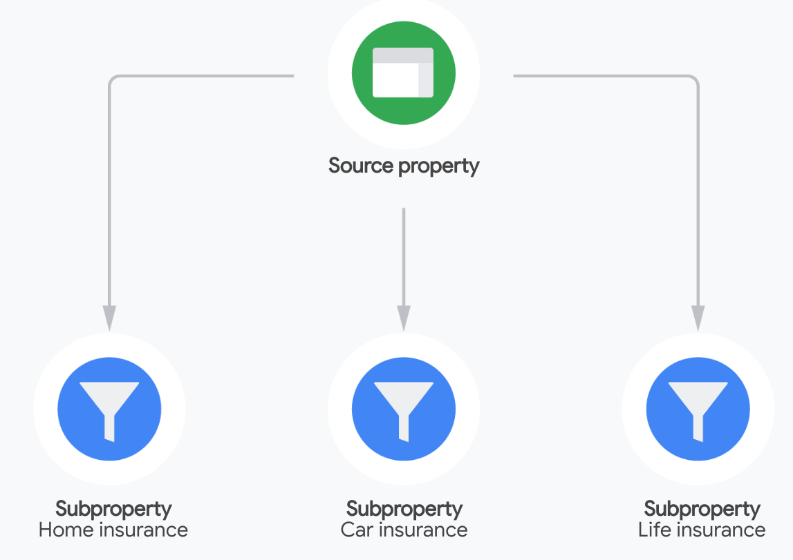
2. Hiroko's retail company  
   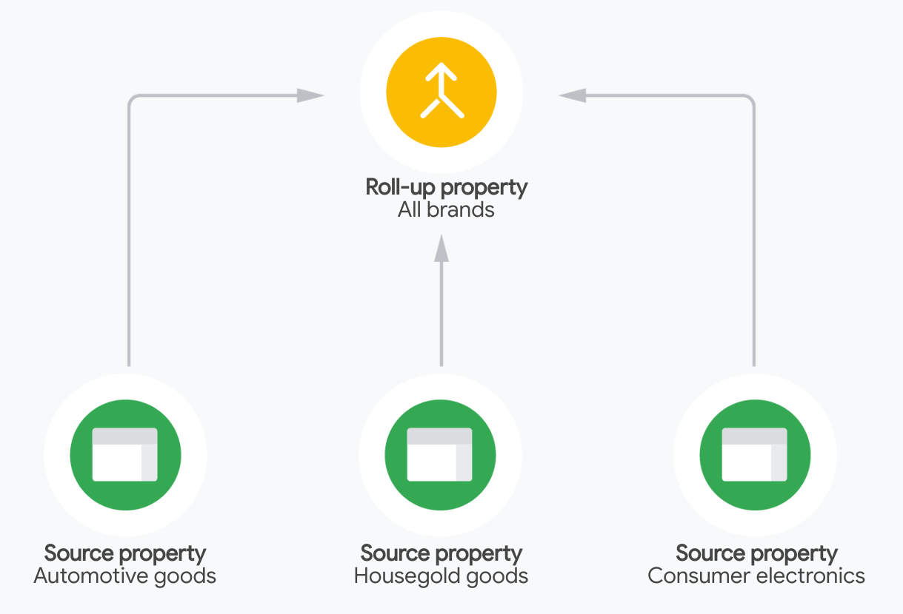
3. Hiroko's customer loyalty program  
   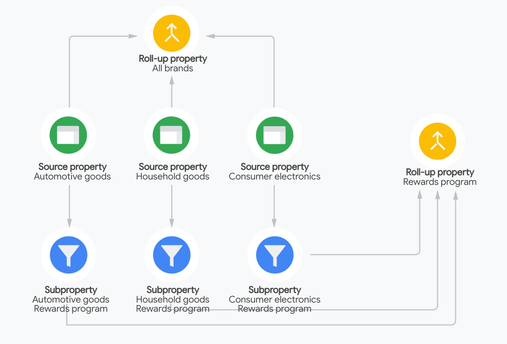

### 3. Enterprise-level performance and features

1. Monitor changes in your property. When multiple teams work together with your Analytics property, you may want to closely monitor the changes made to your account settings. Analytics 360 has a more robust Change History so you can review when settings are edited, like when a new Google Ads account is linked to an Analytics 360 property or a new type of conversion is created.
2. Know when your data is ready. Analytics 360 comes with service-level agreements (SLAs) across many product functionalities, such as data collection, reporting, processing, and attribution. There's also an SLA for BigQuery daily export, to provide peace of mind for your own analysis.

### 4. Higher limits for enterprises

1. Event parameters  
   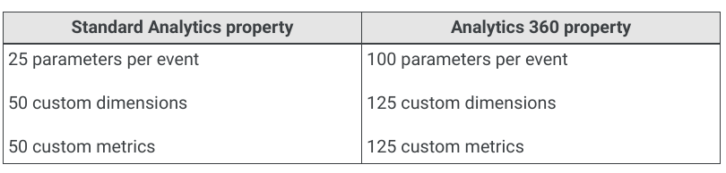
2. Conversions  
   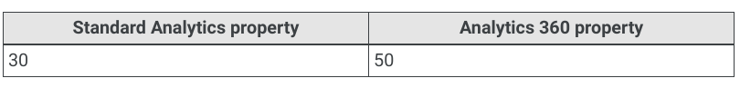
3. Audiences  
   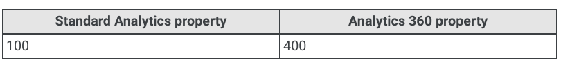
4. Data retention  
   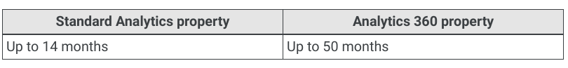
5. BigQuery export  
   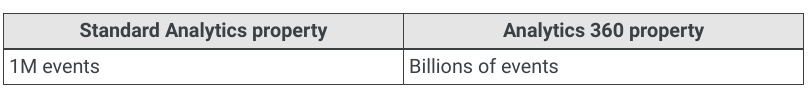

### 5. Key takeaways

1. Subproperties and roll-up properties are options in Analytics 360 to give you more flexibility for account structure.
2. Analytics 360 allows you to monitor changes more closely, and comes with service-level agreements.
3. There are higher limits for things like conversions and audiences in Analytics 360.

Share:
