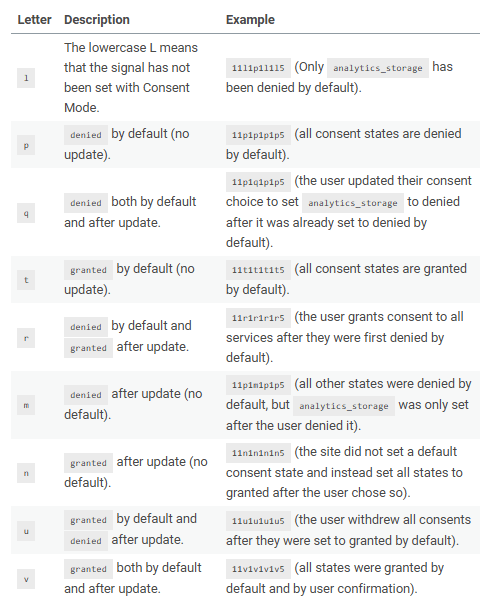
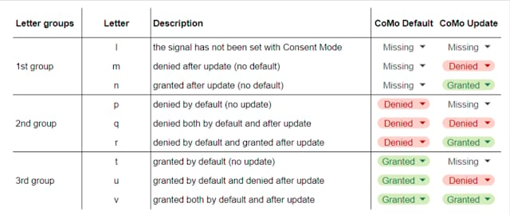

**I have a problem: I don't remember things :)**That's why my Google Calendar is full of memos even for personal stuff I'm supposed to remember.

Given this premise, **you can probably imagine how much I hate the new gcd parameter**, the parameter associated with Consent Mode v2 - populated with consent for the new signals ad\_user\_data and ad\_personalization.

### The gcd parameter in GA4 network requests

For those who don't know what I'm talking about, I strongly recommend having a look [at this guide on the Simo Ahava's blog](https://www.blogger.com/blog/post/edit/4558571487857691249/1710232112511730921#) authored by [Markus Baersch](https://www.blogger.com/blog/post/edit/4558571487857691249/1710232112511730921#), to get a deeper understanding of Consent Mode v2 and the gcd parameter.

For the sake of this post, **I will summarize here the main components of this parameter.** The value passed in the gcd parameter consists of:

* first two integers, e.g. 11
* followed by a letter to represent the status of the ad\_storage consent signal, for instance p
* followed by another integer separating the above consent signal from the next one, e.g. 1
* a letter to represent the status of the analytics\_storage consent signal, e.g. another p
* integer, e.g. 1
* letter - e.g. p - for the ad\_user\_data consent signal
* integer, 1
* letter - p - for the ad\_personalization consent signal
* finally, another integer to close the string, for instance 5.

Taking the above example, **the value passed in the gcd parameter would be 11p1p1p1p5**.

I don't know what people think about this parameter butI find it a bit confusing **and the meaning of the letters representing consent signals is hard to remember** since they are not limited to the p I 've used in my example: There are 9 of them!

### How beautiful is the gcs parameter instead

The good old **gcs parameter is instead straightforward in my opinion** since it uses binary numbers to represent the two main consent signals ad\_storage and analytics\_storage. It's dead simple:

* G1 is always there, thus can be ignored
* then there's the ad\_storage consent signal, either 1 if it's been granted or 0 if not
* finally there's the analytics\_storage consent signal, again 1 or 0 wheter consent has been given or not.

How simple is that? I immediately read that, for instance, **G101 means analytics\_storage is granted while ad\_storage is not**, and so on for any other possible combination.

### The trick I found to remember how to read the gcd parameter

Serendipity, as usual, has shown me the way again this time. I was playing with a table taken from the guide I mentioned on Simo's blog, when sorting the rows on Google Sheets I realized there was a pattern.

[The table taken from Simo's blog (credits)](https://www.simoahava.com/analytics/consent-mode-v2-google-tags/#consent-mode-v2-signals)

**A simple alphabetical sorting in the** ***Letter*** **column unveils there are 3 letter groups:**

1. the 1st letter group (l, m, n) represents consent signals where the default command is not recorded altogether
2. the 2nd one (p, q, r) represents consent signals where the default command sets to denied
3. the 3rd one (t, u, v) represents consent signals where the default command sets to granted.

**Then, each letter of each letter group represents the consent signal after the update command has been executed.** Therefore:

1. letters in the 1st position (l, p, t) represent consent signals where the update command is missing
2. letters in the 2nd position (m, q, u) represent consent signals where the update command sets to denied
3. letters in the 3rd position (n, r, v) represent consent signals where the update command sets to granted.

**I know this can still be a bit confusing so the table below is worth a thousand words.**

The table that helped me understand how to read the gcd parameter

### Conclusions

I guess there are other people who already found that pattern and are using it to read the gcd parameter. Some other people are instead ignoring this topic altogether.

**However, I hope there's someone else who will find this tip useful for the day by day debugging.**
