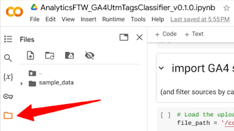
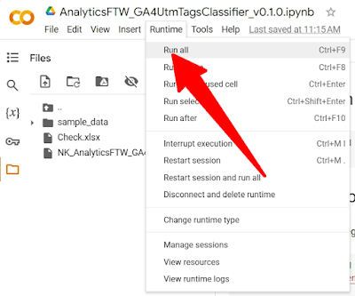
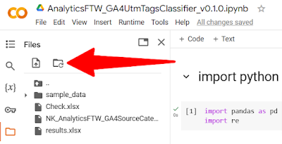

Last summer I've attended the [GA4 Summit](https://ga4summit.it/) event organized by Tag Manager Italia, here in Italy. In particular I remember **a talk by Steen Rasmussen titled "Campaign tracking and attribution in GA4 - Tips, tricks and tactics"**, an inspiring one - as always by Steen, as far as I can tell - about the new importance of campaign tracking caused by the transition to GA4.

Starting from there, in the last few months I focused my attention on campaign tracking, especially how to tag campaigns and how they are assigned to GA4 default channel groups. Some tools came in handy, for instance the **[UTMprep.com](http://UTMprep.com) by Steve Lamar**, but then taking the course **[Query GA4 Data In Google BigQuery](https://www.teamsimmer.com/all-courses/query-ga4-data-in-google-bigquery/) by Johan van de Werken and Simo Ahava**I realized there were chances to programatically optimize the validation of UTM tags lists which is quite an expensive task.

Here's why I decided to take a step forward using Python and Colab to create a script with this purpose in mind. This post is about how the script I created works and how to use it, for anyone interested.

## How to use the GA4 UTM tags classifier

For **those experienced in Python who want to dig deeper**how the script works please jump to the next section of this post.

For **those scared by the code, take a breath, you can simply ignore it** since Colab will do everything for you. Please keep reading this section since it includes a step by step guide on how to use my script.

**For both, the script [is available at this link](https://github.com/giancampo/digital-analytics-python-scripts/blob/main/AnalyticsFTW_GA4UtmTagsClassifier_v0_1_0.ipynb).**

### 1. Open the script in Colab

In the Github page I provided above there's a blue button "Open in Colab": That's the recommended way to rapidly use the script without installing Python or other boring stuff :)

### 2. Sign-in with a Google account

Then click the folder icon on the left side panel of Colab. After a while you will see a folder named "sample\_data" appearing but you can ignore it since we need to upload our own files there.

*Clicking the folder icon in Colab to add files*

### 3. Upload the files to process

We need two files to make the script work.

* The 1st one is a list of GA4 source categories, the one Google references in its documentation, [available at this link](https://storage.googleapis.com/support-kms-prod/qn1xhBu8MVcZPIZ2WZMNdI40FtZXFPGYxj2K). Unfortunately it's a PDF, which is crazy in my opinion considering it's even mentioned as a spreadsheet by Google itself. This is why I copy/pasted the content of the PDF in a real spreadsheet that [I'm making available at this link](https://docs.google.com/spreadsheets/d/1SDPBvJN4Pgzpm3XNEv8-Vq0uwxffYo3M/edit?usp=sharing&ouid=112973409300091952502&rtpof=true&sd=true) (safely stored on Google Drive).
* The 2nd file is another spreadsheet with the list of source, medium and campaign parameters to validate. This must have three columns named exactly "Source", "Medium" and "Campaign".

Both the files have to be named exactly as I did. Therefore, the 1st one must be named "NK\_AnalyticsFTW\_GA4SourceCategories.xslx", the 2nd one "Check.xslx".  

### 4. Run all code cells in the Colab notebook

To do so, you have to click Runtime / Run all found at the top navigation bar in Colab.

*Clicking Run All in the Colab notebook to execute the script*

### 5. Get the results file and enjoy!

Once the script ends its execution you will find another file inside the Files section of Colab. Just download the file and start your assessment in Excel or any spreadsheet software of your choice.

If you don't see a file named "results.xslx" immediately, just hit the Refresh button as in the snapshot below.

*Clicking the refresh button in Colab to update the Files section*

## Explanation of the GA4 UTM tags classifier, for coders

In this section I will explain the script almost line by line in order to understand how it works. This is especially important for experienced coders who want to help reviewing my code or just customizing it.

If you're wondering, I don't think I'm a good Python coder so let me precise most of the code has been created using ChatGPT and then I added something here and there to make it work as I wanted.

*Disclaimer: Google Blogger does not allow me to paste code blocks easily so the excerpts you're going to find here are just meant as references.*

### 1. Import python libraries

We just need a couple of simple libraries for this script to work:

* *pandas* manages data frames
* *re* is the library we need to process the RegEx Google uses to interpret some parameters.

### 2. Import GA4 source categories file

Here we load the file with the list of source categories taken from Google documentation. For those jumping right here, as I previously wrote, I copy/pasted the content of the PDF in a spreadsheet [I'm making available at this link](https://docs.google.com/spreadsheets/d/1SDPBvJN4Pgzpm3XNEv8-Vq0uwxffYo3M/edit?usp=sharing&ouid=112973409300091952502&rtpof=true&sd=true) (safely stored on Google Drive).

==============================

# Load the uploaded Excel file

file\_path = '/content/NK\_AnalyticsFTW\_GA4SourceCategories.xlsx'

# Assuming the values are in the first column of the first sheet, we'll read that column

values\_df = pd.read\_excel(file\_path)

==============================

After reading the file, the cell code filters rows creating the following sublists: *SOURCE\_CATEGORY\_SHOPPING*, *SOURCE\_CATEGORY\_SEARCH*, *SOURCE\_CATEGORY\_SOCIAL* and *SOURCE\_CATEGORY\_VIDEO*.

==============================

# Filtering the values from the Excel file where 'source category' is 'SOURCE\_CATEGORY\_SHOPPING'

filtered\_shopping\_sources = values\_df[values\_df['source category'] == 'SOURCE\_CATEGORY\_SHOPPING']['source'].tolist()

==============================

### 3. Upload the file to check

The next cell reads the file with the list of source, medium, campaign parameters we want to assess.

==============================

uploaded\_file\_path = '/content/Check.xlsx'

df = pd.read\_excel(uploaded\_file\_path, na\_filter=False)

==============================

### 4. Map the input UTM tags

Finally, the last cell in the notebook is the main part of the script.

**The first part gives a name to any possible RegEx patterns to use afterwards**. I've decided to keep each possible pattern distinct even if they are actually duplicates of others since I wanted to be  prepared for any possible future change.

==============================

# Define the regex patterns

# Some of them are duplicates but they could change in the future

paid\_shopping\_campaign\_pattern = r'^(.\*(([^a-df-z]|^)shop|shopping).\*)$'

==============================

**Then, comes the core function check\_condition.**

The first rows of the function take the columns of the Excel to convert their content in lower cases. I have to say thanks to Luka Cempre about this part since looking [at the SQL code he posted on Linkedin](https://www.linkedin.com/posts/luka-cempre-9b5ba71a_the-google-analytics-4-export-to-bigquery-activity-7154241690692694016-Xvma) I noticed my code was missing it.

==============================

Source = row['Source'].lower()

Medium = row['Medium'].lower()

Campaign = row['Campaign'].lower()

==============================

An if, elif, else statement is in charge of assigning the parameters to GA4 default channel groups. The order of the lines is the same that can be found [in the table "Channels for manual traffic" in Google Analytics Help](https://support.google.com/analytics/answer/9756891?hl=en#:~:text=Channels%20for%20manual%20traffic).

==============================  
if Source == '(direct)' and Medium in ['(not set)', '(none)']:  
return 'Direct'  
  
elif Campaign == 'cross-network':  
return 'Cross-network'  
  
elif Source in filtered\_shopping\_sources or (re.match(paid\_shopping\_campaign\_pattern, Campaign) and re.match(paid\_shopping\_medium\_pattern, Medium)):  
return 'Paid Shopping'

==============================  
  
In the code above, I extracted some lines from the function to show how a *Direct*, *Cross-network* and *Paid Shopping* channel groups are assigned to source, medium and campaign parameters. Both the RegEx patterns showed earlier in this section and values with lower case kick in here to make the code more readable.

Finally, this code cell applies the Python function to the rows to check and the data frame is exported to an Excel file named "results.xslx".  
  
==============================  
# Apply the function to each row  
df['Default channel group'] = df.apply(check\_condition, axis=1)

# Display the DataFrame

#df.head()

# Export the DataFrame

df.to\_excel("results.xlsx", sheet\_name='UTM tagging classification', index=False)

==============================

## Final thoughts

I hope the script I created will help classifying UTM parameters into GA4 channel groups as smoothly as possible!

I find Google documentation to be hard to understand for average marketers and all the steps required to do so are too time-consuming.

Hopefully, Google will change something in the future, but for now, my little script can be one of the ways to go.

Share:
